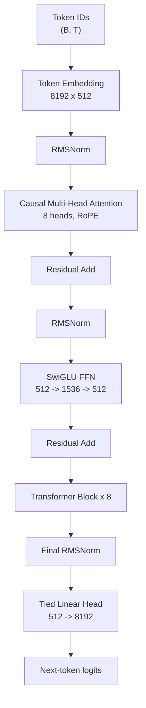

# PipTransformer

A compact, from-scratch decoder-only Transformer trained on
[TinyStories](https://huggingface.co/datasets/roneneldan/TinyStories). The project is written as a
single, heavily commented Jupyter notebook so that every part of the pipeline is visible: tokenizer
training, model architecture, data preparation, optimization, checkpointing and generation.

The model is the same family as Llama: pre-norm residual blocks, RMSNorm, rotary position embeddings
(RoPE), SwiGLU feed-forward layers, bias-free linear layers and tied input/output embeddings.

## Results

Trained for 2,000 steps on an Apple Silicon GPU (MPS, `bf16` autocast):

| Metric | Value |
| --- | --- |
| Parameters | 31,465,984 |
| Layers / heads / width | 8 / 8 / 512 |
| SwiGLU hidden width | 1,536 |
| Context length | 512 |
| Vocabulary | 8,192 (Byte-Level BPE) |
| Training tokens | 17,404,117 |
| Validation tokens | 382,705 |
| Optimizer | AdamW (`lr=1e-3`, cosine decay to `1e-4`) |
| Effective batch | 64 sequences |
| Final validation loss | 1.7293 |
| Final validation perplexity | 5.64 |
| Throughput | ~23k-28k tokens/s (MPS) |

Validation-loss curve:

| Step | Loss | Perplexity |
| --- | --- | --- |
| 200 | 3.0136 | 20.36 |
| 600 | 2.1047 | 8.20 |
| 1000 | 1.8796 | 6.55 |
| 1400 | 1.7771 | 5.91 |
| 1800 | 1.7326 | 5.66 |
| 2000 | **1.7293** | **5.64** |

### Sample generation

Prompt: `Once upon a time, a little girl named Lily`

> Once upon a time , a little girl named Lily wanted to help her mom in the kitchen . She asked her
> mom if she could help . Her mom said yes , but told Lily to be careful .
>
> Lily ran to get the soap and then she poured some into the sink . But when she poured it , the water
> started to splash out of the sink ! Lily tried to stop it , but it was too late . She got so dirty
> that ...

This sample comes from the original 2,000-step checkpoint. It was generated with an earlier build in
which the ByteLevel space markers (`Ġ`/`Ċ`) were not decoded; the text above has those markers
normalized to spaces/newlines for readability. The notebook in this repo attaches the ByteLevel
decoder, so new generations are decoded correctly. The spaces before punctuation are produced by the
BPE merges (space + punctuation tokens), not by a decoding bug.

## Architecture



## Quickstart

```bash
python -m venv .venv
source .venv/bin/activate          # Windows: .venv\Scripts\activate
pip install -r requirements.txt
jupyter lab pip_transformer_tinystories.ipynb
```

Run the cells top to bottom. On the first run the notebook:

1. downloads TinyStories,
2. trains an 8,192-token Byte-Level BPE tokenizer,
3. tokenizes the corpus into memory-mapped `uint16` files.

Those artifacts are cached under `tokenizer/` and `data/`. Later runs reuse the cache and jump
straight to training. A full 2,000-step run takes roughly 45-50 minutes on an M-series Mac; a CUDA GPU
is faster.

The notebook selects `mps`, `cuda` or `cpu` automatically.

### Optional: computational graph

Rendering the graph needs `torchviz` plus the Graphviz system package:

```bash
pip install torchviz
brew install graphviz          # macOS
# sudo apt-get install graphviz  # Debian/Ubuntu
```

Then set `PLOT_ARCH = True` in the last code cell.

## Notebook contents

| Section | What it covers |
| --- | --- |
| 1. Environment setup | imports, device selection, deterministic seeding |
| 2. Configuration | typed `Config` dataclass for every hyperparameter |
| 3. Dataset and tokenizer | TinyStories, Byte-Level BPE, **decoder fix** |
| 4. Model architecture | RMSNorm, RoPE, causal attention, SwiGLU, blocks |
| 5. Instantiate the model | parameter count, weight tying, forward-pass check |
| 6. Sampling utility | reusable `generate()` with temperature and top-k |
| 7. Sanity check | initial loss should be near `ln(8192) = 9.01` |
| 8. Before training | sample from the untrained model |
| 9. Token cache | flat `uint16` streams, memmap, cache fingerprinting |
| 10. Training loop | AdamW, gradient accumulation, AMP, warmup + cosine |
| 11. Save a checkpoint | weights, optimizer, config and tokenizer hash |
| 12. Resume | rebuild model and optimizer from a checkpoint |
| 13. Attention inspection | recompute and plot causal attention per head |
| 14. Generation | sample a story with the trained model |
| 15. Optional graph | render the computation graph with `torchviz` |

## Repository structure

```
.
├── pip_transformer_tinystories.ipynb   # the complete, commented pipeline
├── README.md
├── requirements.txt
├── LICENSE
├── .gitignore
└── microgpt.py                         # separate, dependency-free GPT demo (not used here)
```

Generated artifacts are intentionally ignored:

- `tokenizer/` and `data/` are rebuilt automatically on first run;
- `checkpoints/` (and legacy `checkpoints_*/`) contain `.pt` files of a few hundred MB.

## Design notes

- **Weight tying.** The output projection shares the token-embedding matrix, saving `8192 x 512`
  parameters and typically improving small-model quality.
- **RoPE.** Position information is applied by rotating queries and keys in 2-D channel pairs. The
  rotation phases are precomputed once and stored in a non-persistent buffer, so they are not
  duplicated in checkpoints.
- **Fused attention.** `torch.nn.functional.scaled_dot_product_attention(..., is_causal=True)`
  applies the causal mask inside the kernel. Section 13 rebuilds the attention probabilities
  explicitly so they can be plotted and checks the causal property numerically.
- **Gradient accumulation.** Four micro-batches of 16 sequences produce an effective batch of 64,
  which keeps memory use low without shrinking the batch.
- **Tokenizer sample size.** The tokenizer is trained on 50k stories while the model trains on 80k.
  This speeds up the first run and leaves the vocabulary essentially unchanged for this corpus.

## Limitations

- Trained only on TinyStories, so it writes simple children's stories and nothing else.
- 512-token context and 31.5M parameters: this is an educational/reference model, not an assistant.
- Full bitwise determinism is not guaranteed on MPS or CUDA, although seeding removes the usual
  sources of variation.

## Acknowledgements

- TinyStories: Ronen Eldan and Yuanzhi Li, *TinyStories: How Small Can Language Models Be and Still
  Speak Coherent English?* (2023).
- Architecture: Llama (RoPE, SwiGLU, pre-norm, RMSNorm) and GPT-2-style weight tying.
- `microgpt.py` in this repository is Andrej Karpathy's minimal dependency-free GPT implementation
  and is unrelated to the notebook.

## License

MIT. See [LICENSE](LICENSE).
